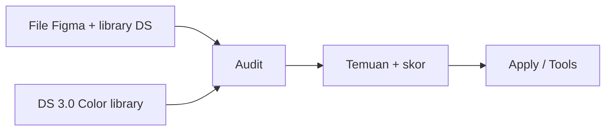

# DESIGN AUDIT SAWITPRO

Plugin Figma untuk **mengaudit kepatuhan Design System** di file desain SawitPRO. Audit **deterministik** di dalam plugin: **tanpa LLM**, **tanpa export/import JSON dari UI**, **tanpa REST API**, **tanpa menyimpan token** di repository.

**Repo GitHub:** [github.com/sapikkk/design-audit-sawitpro](https://github.com/sapikkk/design-audit-sawitpro)

**Versi plugin (prompt/):** 2.2 — lihat [`CHANGELOG.md`](CHANGELOG.md).

---

## Peta repo (jelas)

| Path | Isi |
|------|-----|
| [`prompt/`](prompt/) | **Plugin siap pakai** — `code.js`, `ui.html`, `rules.json`, ikon |
| [`manifest.json`](manifest.json) | Entry Figma → arahkan ke `prompt/` |
| [`icon.png`](icon.png) | Ikon 128×128 untuk **Publish** plugin org |
| [`docs/agent/`](docs/agent/) | Perbandingan Community, MCP DS, publish icon, referensi semantic layer |
| [`AGENTS.md`](AGENTS.md) | Aturan agent + **commit/push otomatis** |
| Root `code.ts` | Template resmi Figma (stub); plugin lengkap di `prompt/` |

---

## Fitur utama (v2.2)

| Tab | Fungsi |
|-----|--------|
| **Audit** | Seleksi / halaman / semua file · skor · coverage token · filter & grup ×N |
| **Apply** | Bind **EXACT** (fill/stroke/spacing/type) · undo · anotasi `🔍 DS Audit` |
| **Tools** | Detach variabel · remap A→B pada seleksi · `[no-tokens]` di deskripsi komponen |

Parity vs plugin Community: [`docs/agent/community-linter-comparison.md`](docs/agent/community-linter-comparison.md).

Roadmap referensi (deteksi komponen, rename semantic): [`docs/agent/figma-semantic-layer-references.md`](docs/agent/figma-semantic-layer-references.md). Plugin saat ini fokus audit variabel/komponen library via INSTANCE + penamaan `rules.json`; fingerprint struktural belum ada.

---

## Cara kerja

1. Aktifkan library Design System di file.
2. Import plugin dari [`manifest.json`](manifest.json).
3. Jalankan audit → perbaiki via Apply/Tools.

Detail: [`prompt/README.md`](prompt/README.md).

**Checklist tim (import → audit → publish):** [`docs/agent/team-rollout.md`](docs/agent/team-rollout.md).

---

## Instalasi

1. Clone repo.
2. Figma → **Plugins → Development → Import plugin from manifest** → pilih `manifest.json` di root.
3. Sesuaikan `"id"` di manifest dengan plugin development Anda.
4. Publish org (opsional): [`docs/agent/figma-plugin-icon-publish.md`](docs/agent/figma-plugin-icon-publish.md).

---

## Skor

| Skor | Status |
|------|--------|
| ≥ 90 | EXCELLENT |
| 75–89 | PASS_WITH_WARNING |
| &lt; 75 | REJECTED |

Kategori **VARIABLE** (bind orphan/alias) ikut bobot — lihat `prompt/rules.json`.

---

## Kontribusi & git

- Setelah perubahan: **commit + push** (kebijakan repo: `.cursor/rules/auto-push.mdc`).
- Issue/PR: repositori **design-audit-sawitpro**.
