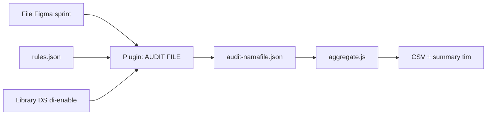

# DESIGN AUDIT SAWITPRO

Plugin Figma untuk **mengaudit kepatuhan Design System** di file desain SawitPRO. Audit berjalan **deterministik** (JavaScript di plugin + script Node lokal), **tanpa LLM** saat runtime, **tanpa REST API** Figma, dan **tanpa menyimpan token** di repository.

---

## Apa isi repositori ini?

| Bagian | Peran | Mulai dari sini |
|--------|--------|-----------------|
| [`prompt/`](prompt/) | **Implementasi plugin DS Audit Pro (v2)** — `code.js`, `ui.html`, `rules.json`, `aggregate.js` | Pelajari & jalankan plugin di Figma |
| Root (`code.ts`, `manifest.json`, …) | **Template resmi Figma** (TypeScript + build). Saat ini `code.ts` masih stub; plugin lengkap ada di `prompt/` | Jika ingin migrasi ke TS + ESLint |
| [`docs/`](docs/) | Dokumentasi tim (produk, testing, standar temuan audit, desain, agent Cursor) | Konteks proses & format laporan |
| [`prompt/ds-audit-plugin-spec.md`](prompt/ds-audit-plugin-spec.md) | **Spesifikasi build** (brief untuk developer) | Arsitektur, mode plugin, skor, batasan API |

---

## Cara kerja (ringkas)



1. Di file sprint, **aktifkan library Design System** (Assets → Libraries).
2. Jalankan plugin → mode **AUDIT FILE** → ekspor JSON ke folder `exports/`.
3. Ulangi per file; di terminal: `npm run aggregate` (dari folder `prompt/`) → laporan di `reports/`.

Detail alur harian: [`prompt/README.md`](prompt/README.md).

---

## Jalur belajar (disarankan)

1. **Prinsip & batasan Figma API** — baca [`prompt/README.md`](prompt/README.md) (bagian “Yang ditemukan otomatis”, skor ≥90 / 75 / &lt;75).
2. **Spesifikasi lengkap** — [`prompt/ds-audit-plugin-spec.md`](prompt/ds-audit-plugin-spec.md) (mode AUDIT, EXACT fix, anotasi, agregat).
3. **Kode plugin** — `prompt/code.js` (logika scan) dan `prompt/ui.html` (UI Bahasa Indonesia).
4. **Aturan bobot & ambang** — `prompt/rules.json`.
5. **Laporan tim** — `prompt/aggregate.js`.
6. **Standar temuan (dokumen)** — [`docs/standards/format-temuan-audit.md`](docs/standards/format-temuan-audit.md).

---

## Instalasi plugin (tim desain)

1. Clone repositori ini.
2. Figma → **Plugins → Development → Import plugin from manifest**.
3. Pilih [`prompt/manifest.json`](prompt/manifest.json).
4. Ganti `"id"` di manifest dengan ID unik dari Figma saat plugin development dibuat.
5. `npm install` di root **atau** hanya pakai `prompt/` jika tidak memakai TypeScript di root.

Build TypeScript (root template):

```bash
npm install
npm run build    # atau npm run watch
```

Agregat laporan (setelah ada JSON di `exports/`):

```bash
cd prompt
npm run aggregate
```

---

## Skor kepatuhan

| Skor | Status |
|------|--------|
| ≥ 90 | EXCELLENT |
| 75–89 | PASS_WITH_WARNING |
| &lt; 75 | REJECTED |

Rata-rata berbobot per kategori; kategori tanpa objek yang bisa dicek tidak dihitung (bobot dinormalisasi).

---

## Lisensi & distribusi

Plugin distribusi internal lewat GitHub + import manifest (Figma Professional). Jangan commit token, `.env`, atau export sensitif — lihat [`.gitignore`](.gitignore).

---

## Kontribusi

Issue dan PR di GitHub: **design-audit-sawitpro** (organisasi/username: `sapikkk`).
