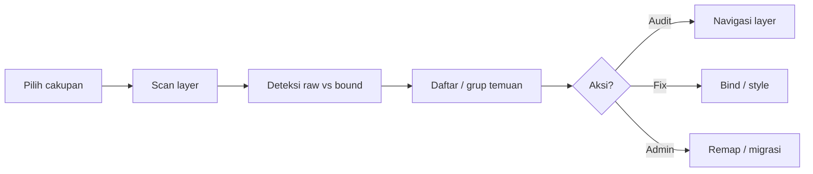

# Perbandingan plugin Community vs Design Audit SawitPRO

Dokumen ini merangkum alur plugin linter/audit variabel di Figma Community, fitur SawitPRO, dan status parity.

## Alur umum (Community)

## Matriks fitur (status v2.2)

| Fitur | Community (contoh) | **SawitPRO** |
| :--- | :--- | :---: |
| Scan seleksi / halaman / file | Variables audit, Varlint | ✅ |
| Raw fill / stroke / size | Varlint | ✅ |
| Spacing, radius, typography, auto layout | Variable Auditor, YADL | ✅ |
| Skor + coverage bar | Variables audit | ✅ |
| Grup temuan ×N | Varlint | ✅ |
| Bind EXACT + undo | Varlint (paid bind) | ✅ |
| Orphan / alias putus | Variables Lint | ✅ |
| Unused variable sample | Variables Lint | ✅ |
| Mode lint (celah mode lokal) | YADL | ✅ |
| `[no-tokens]` skip | Variables audit | ✅ |
| Detach variabel | Variables audit | ✅ |
| Remap A→B (seleksi) | TokenOps (full migrasi) | ✅ (seleksi/halaman detach) |
| Anotasi halaman audit | — | ✅ |
| Kategori file + DS 3.0 theme | — | ✅ |
| Migrasi massal antar file / REST | TokenOps | ❌ sengaja |
| Export JSON dari plugin | — | ❌ kebijakan internal |

## Yang sengaja tidak diduplikasi

1. **Migrasi find-replace file-wide** tanpa change control (TokenOps) — remap internal hanya seleksi/halaman detach.
2. **Tokens Studio sync** — library Figma native.
3. **Export audit JSON** — agregat offline via repo.

## Cara pakai (lengkap)

1. **Audit** — cakupan → jalankan → filter / grup → navigasi layer.
2. **Apply** — EXACT saja → pulihkan / anotasi.
3. **Tools** — detach bind; remap variabel (muat katalog → pilih A/B → seleksi di kanvas).
4. Komponen library: tambahkan `[no-tokens]` di **deskripsi** komponen untuk mengecualikan instance dari scan.

## File teknis

- `prompt/code.js` — audit, apply, tools
- `prompt/ui.html` — UI shadcn-inspired
- `prompt/rules.json` — bobot & pola (sync ke `AUDIT_RULES`)
